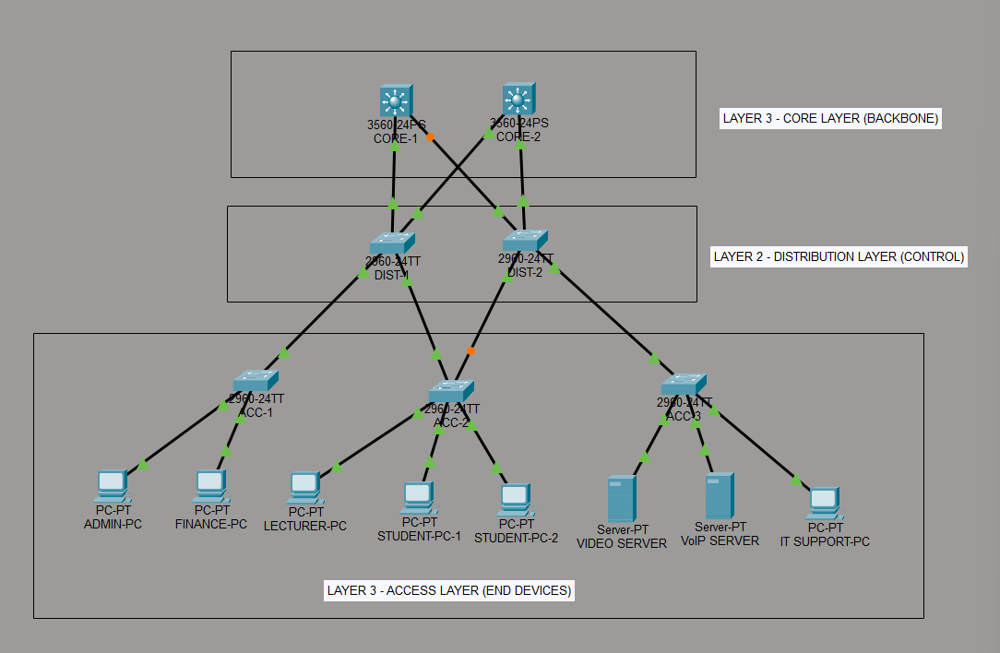
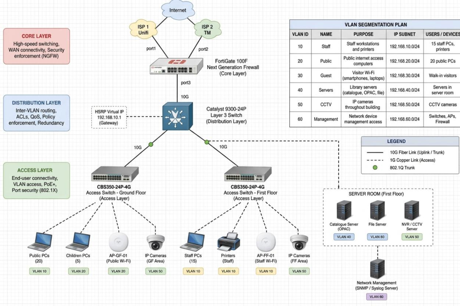
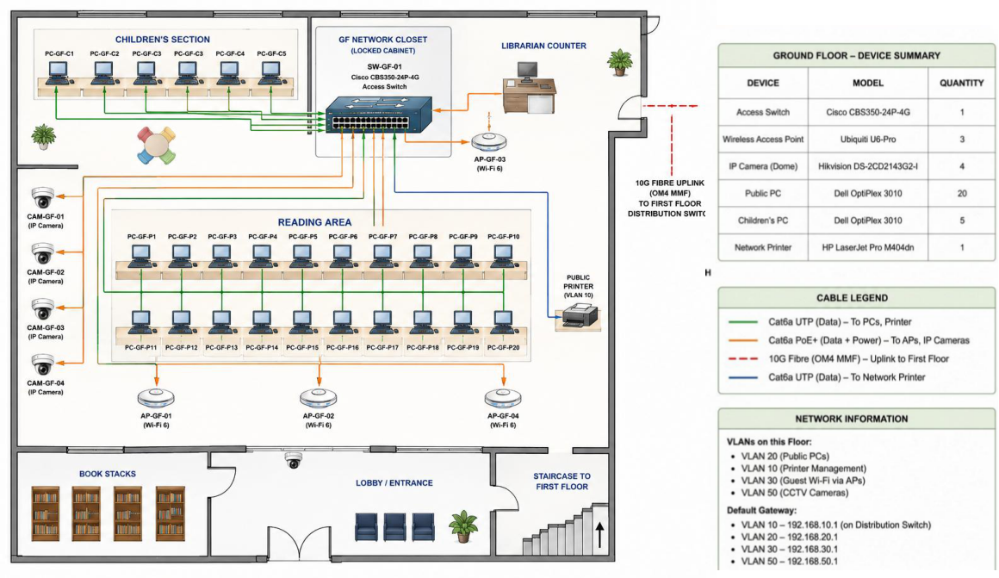
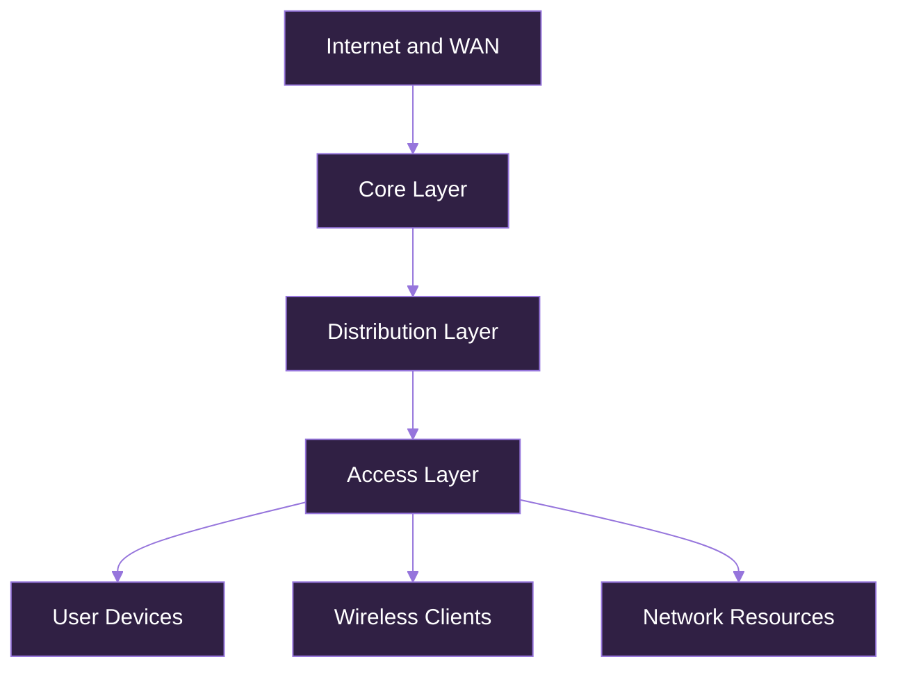
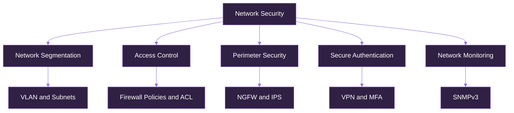
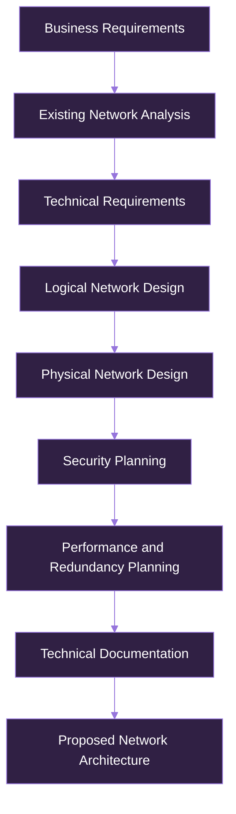

<div align="center">


*Designing Secure, Scalable and Reliable Network Infrastructure.*

</div>

---

## 01 / Repository Overview

This repository showcases my academic network design projects completed as a Bachelor of Computer Science (Hons.) Netcentric Computing student at Universiti Teknologi MARA (UiTM).

The projects focus on enterprise network architecture, logical and physical network design, network security, routing and switching, infrastructure scalability and high availability.

This portfolio demonstrates my foundational knowledge and technical understanding of designing secure and reliable network infrastructure based on organizational requirements.

## 02 / Project Objectives

- Design scalable enterprise network architectures.
- Apply hierarchical network design principles.
- Develop structured IPv4 addressing and subnetting plans.
- Improve network security through segmentation and access control.
- Optimize network performance using Quality of Service (QoS).
- Design redundant and highly available infrastructure.
- Plan centralized network services and monitoring.
- Develop professional technical documentation.

## 03 / Technologies and Networking Concepts

<div align="center">


</div>

| Category | Technologies and Concepts |
| --- | --- |
| Network Architecture | Three-Tier Hierarchical Network Design |
| Network Segmentation | VLAN, Subnetting, Inter-VLAN Routing |
| Routing and Switching | OSPF, Layer 2 and Layer 3 Switching |
| Network Services | DHCP, DNS, IPv4 Addressing |
| Network Security | Firewall Policies, ACL, IPS, 802.1X |
| Secure Remote Access | SSL VPN, MFA |
| Network Performance | QoS, DSCP, LLQ, CBWFQ |
| High Availability | HSRP, VRRP, EtherChannel, RSTP |
| WAN Connectivity | Dual ISP, SD-WAN |
| Network Monitoring | SNMPv3, Centralized Monitoring |
| Physical Infrastructure | Gigabit Ethernet, 10G Fiber, Cat6a, Wi-Fi 6 |

## 04 / Featured Projects

| Project | Project Type | Main Focus | Status |
| --- | --- | --- | --- |
| [EduStream Global](./edustream-global/README.md) | Individual Academic Project | Enterprise Networking, QoS, High Availability | Design Completed |
| [LIBRIFY Public Library](./librify-public-library/README.md) | Group Academic Project | Network Security, Physical Infrastructure, Segmentation | Design Completed |

---

## 05 / EduStream Global Network Design


### Project Overview

An individual academic network design case study focusing on redesigning EduStream Global's existing network infrastructure to support reliable, scalable and high-performance online learning services.

The proposed architecture addresses network congestion, excessive broadcast traffic, high latency, limited scalability and single points of failure.

### Proposed Network Topology



*Figure 1: Proposed hierarchical network architecture of EduStream Global.*

### Key Design Features

- Top-Down Network Design methodology.
- Three-tier hierarchical architecture.
- Multi-site network infrastructure.
- Structured IPv4 addressing.
- Seven dedicated VLANs.
- OSPF dynamic routing.
- Quality of Service for voice and video traffic.
- Redundant network infrastructure.
- Dual ISP connectivity.
- High availability planning.

### VLAN Segmentation

| VLAN | Network |
| --- | --- |
| 10 | Management |
| 20 | Administration |
| 30 | Academic Services |
| 40 | VoIP |
| 50 | Video Streaming |
| 60 | Guest Network |
| 70 | Data Centre |

### Quality of Service

| Traffic | DSCP | Priority |
| --- | --- | --- |
| VoIP | EF (46) | Highest |
| HD Video | AF41 (34) | High |
| LMS Traffic | Policy-based | Medium |
| Best-Effort Traffic | Default (0) | Low |

### Proposed Performance Targets

| Metric | Target |
| --- | --- |
| Network Availability | 99.99% |
| VoIP Latency | Below 150 ms |
| VoIP Jitter | Below 30 ms |
| Packet Loss | Below 1% |

The performance values represent proposed design objectives rather than measured implementation results.

### Project Documentation

- [Full Technical Documentation](./edustream-global/README.md)
- [Original Network Topology Diagrams](./edustream-global/screenshots/)

---

## 06 / LIBRIFY Public Library Network Design


### Project Overview

A collaborative academic network design project focusing on the redesign of LIBRIFY Public Library's existing network infrastructure.

The proposed architecture supports library staff, public computer users, wireless visitors, CCTV systems and digital library services.

The project emphasizes network segmentation, infrastructure security, physical network planning and business continuity.

### Proposed Network Topology



*Figure 2: Proposed hierarchical network architecture of LIBRIFY Public Library.*

### Key Design Features

- Three-tier hierarchical network architecture.
- Six dedicated VLANs.
- Structured IPv4 addressing.
- Layer 3 switching and inter-VLAN routing.
- Centralized DHCP and DNS services.
- FortiGate next-generation firewall.
- Intrusion Prevention System (IPS).
- Secure remote access using SSL VPN and MFA.
- Dual WAN connectivity with SD-WAN.
- Centralized network monitoring using SNMPv3.
- Enterprise Wi-Fi 6 infrastructure.
- Physical network and structured cabling design.

### VLAN and IP Addressing Plan

| VLAN | Network | Subnet |
| --- | --- | --- |
| 10 | Staff | 192.168.10.0/24 |
| 20 | Public | 192.168.20.0/24 |
| 30 | Guest | 192.168.30.0/24 |
| 40 | Servers | 192.168.40.0/24 |
| 50 | CCTV | 192.168.50.0/24 |
| 60 | Management | 192.168.60.0/24 |

### Physical Network Infrastructure



*Figure 3: Proposed ground floor physical network layout.*

The physical infrastructure proposal includes:

- Ground floor network layout.
- First floor network layout.
- Server room equipment rack.
- Structured Cat6a cabling.
- Fiber backbone connectivity.
- Wireless access point placement.
- Network switch placement.
- CCTV infrastructure.

### Proposed Security Controls

| Security Control | Purpose |
| --- | --- |
| Next-Generation Firewall | Advanced network traffic inspection |
| IPS | Intrusion detection and prevention |
| VLAN Segmentation | Network isolation |
| Firewall Policies | Traffic access restrictions |
| 802.1X | Network access authentication |
| SSL VPN and MFA | Secure remote access |
| Web Filtering | Restrict malicious or inappropriate websites |
| SNMPv3 | Secure network monitoring |

### Proposed Performance Targets

| Metric | Target |
| --- | --- |
| Network Availability | 99.9% |
| Network Failover | Less than 2 seconds |
| WAN Failover | Less than 5 seconds |
| Catalogue Search Response | Less than 2 seconds |
| Wireless Coverage | 100% |
| Future Infrastructure Growth | 30% |

The performance values represent proposed design objectives rather than measured implementation results.

### Project Documentation

- [Full Technical Documentation](./librify-public-library/README.md)
- [Original Network and Physical Infrastructure Diagrams](./librify-public-library/screenshots/)

---

## 07 / Enterprise Network Architecture

Both projects adopt the principles of hierarchical network design.



| Layer | Function |
| --- | --- |
| Core | High-speed network backbone and connectivity |
| Distribution | Routing, traffic management and policy enforcement |
| Access | End-device connectivity and VLAN assignment |

### Benefits

- Improved network scalability.
- Reduced network complexity.
- Simplified troubleshooting.
- Improved network performance.
- Better fault isolation.
- Flexible infrastructure expansion.

## 08 / Network Security Principles

The proposed network architectures incorporate security principles to protect organizational resources and reduce unauthorized access.



### Security Concepts

- Defense-in-depth.
- Principle of least privilege.
- Network segmentation.
- Secure remote access.
- Traffic filtering.
- Network isolation.
- Centralized monitoring.
- Infrastructure resilience.

## 09 / Network Design Methodology

The network design process focuses on understanding organizational requirements before selecting appropriate technical solutions.



The methodology considers:

- Organizational requirements.
- Existing infrastructure limitations.
- Network performance objectives.
- Security requirements.
- Budget and resource considerations.
- Future scalability.
- Business continuity.
- Infrastructure maintainability.

## 10 / Technical Skills Developed

### Networking

- Enterprise network architecture.
- Logical and physical network design.
- IPv4 addressing and subnetting.
- VLAN segmentation.
- Routing and switching concepts.
- Inter-VLAN routing.
- Network service planning.

### Network Security

- Firewall policy design.
- Network access control.
- Defense-in-depth architecture.
- Secure remote access planning.
- Network isolation.
- Intrusion prevention concepts.

### Network Performance and Reliability

- Quality of Service.
- Traffic classification and prioritization.
- Network redundancy.
- High availability architecture.
- WAN failover planning.
- Network monitoring concepts.

### Professional Skills

- Technical documentation.
- Network requirement analysis.
- Infrastructure planning.
- Problem-solving.
- Collaborative project development.
- Technical research.

## 11 / Repository Structure

```text
enterprise-network-design/
├── README.md
│
├── edustream-global/
│   ├── README.md
│   └── screenshots/
│       ├── README.md
│       ├── current-flat-topology.png
│       ├── proposed-hierarchical-topology.png
│       └── redundant-high-availability.png
│
└── librify-public-library/
    ├── README.md
    └── screenshots/
        ├── README.md
        ├── current-flat-topology.png
        ├── hierarchical-network-topology.png
        ├── logical-network-topology.png
        ├── ground-floor-layout.png
        ├── first-floor-layout.png
        └── server-room-rack.png
```

## 12 / Project Status

### EduStream Global

- [x] Existing network analysis.
- [x] Network requirement analysis.
- [x] Hierarchical network design.
- [x] VLAN and IP addressing plan.
- [x] QoS strategy.
- [x] Network redundancy planning.
- [x] Original network topology documentation.
- [x] Academic design documentation.

### LIBRIFY Public Library

- [x] Existing network analysis.
- [x] Network requirement analysis.
- [x] Hierarchical network design.
- [x] Logical network design.
- [x] Physical network design.
- [x] VLAN and IP addressing plan.
- [x] Network security planning.
- [x] WAN redundancy planning.
- [x] Original infrastructure diagrams.
- [x] Academic design documentation.

## 13 / Future Improvements

- [ ] Develop practical Cisco Packet Tracer simulations.
- [ ] Configure VLANs and inter-VLAN routing.
- [ ] Implement OSPF dynamic routing.
- [ ] Configure and test DHCP and DNS services.
- [ ] Implement firewall and access control policies.
- [ ] Validate Quality of Service configurations.
- [ ] Perform network redundancy and failover testing.
- [ ] Develop a dedicated secure network home lab.
- [ ] Explore network automation using Python.
- [ ] Explore virtual firewall environments.
- [ ] Implement centralized network monitoring.
- [ ] Document practical network testing results.

## 14 / Learning Resources

- [Cisco Networking Academy](https://www.netacad.com/)
- [Cisco Documentation](https://www.cisco.com/)
- [Fortinet Documentation](https://docs.fortinet.com/)
- [Wireshark](https://www.wireshark.org/)
- [GNS3](https://www.gns3.com/)
- [RFC Editor](https://www.rfc-editor.org/)
- ITT550 Network Design and Management coursework.

## 15 / Disclaimer

This repository contains academic network design projects completed for educational and professional portfolio purposes.

EduStream Global represents individual academic work, while LIBRIFY Public Library represents collaborative group academic work.

The network architectures, technologies and performance targets presented in this repository are proposed solutions and have not been validated through practical deployment or production testing.

Original network diagrams are included as evidence of academic design work.

---

<div align="center">

### Design. Secure. Connect.

*Building the foundation for secure and reliable enterprise networks.*


[GitHub Profile](https://github.com/rosinss)


</div>
