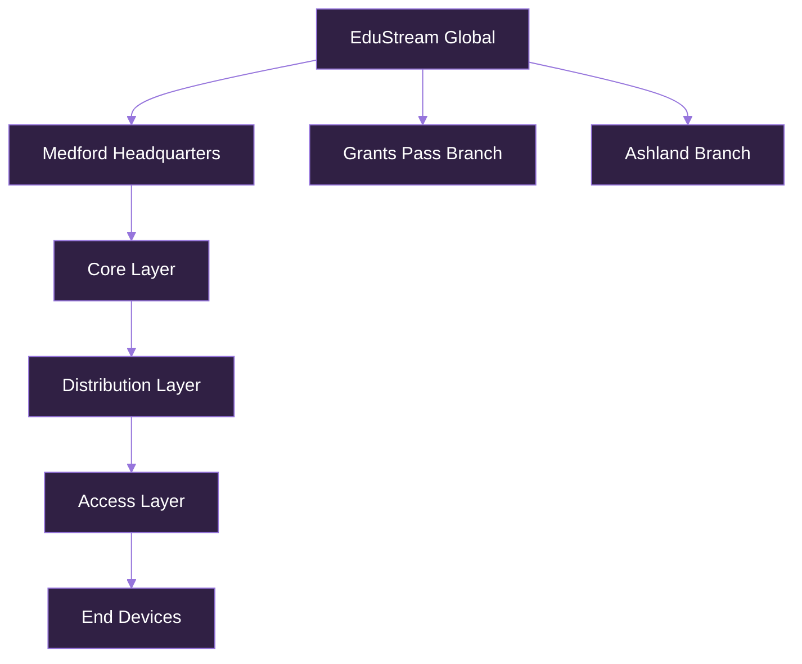
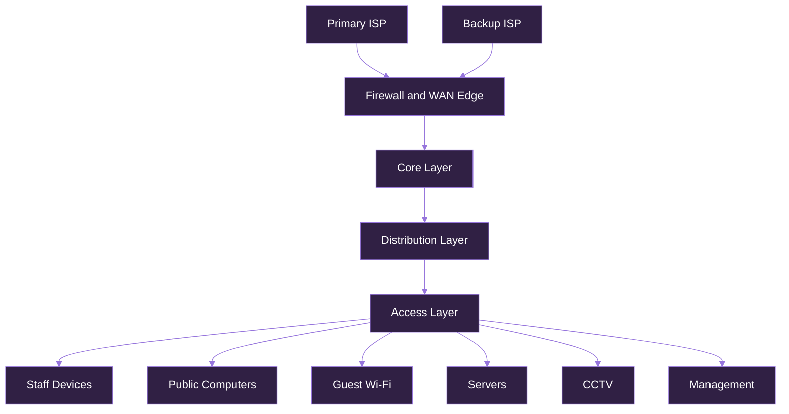
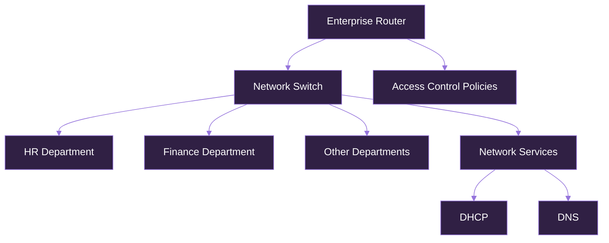
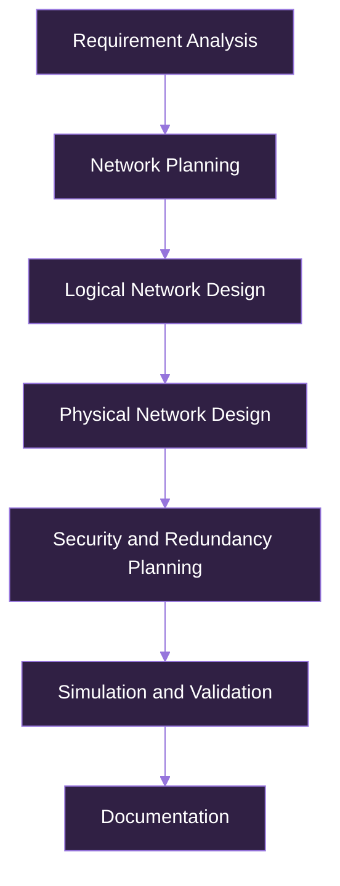

*Design. Connect. Secure. Optimize.*

---

## 01 / Project Overview

This repository showcases my academic and personal networking projects, focusing on enterprise network architecture, network security, scalability, traffic management and infrastructure reliability.

| Project | Type | Focus |
| --- | --- | --- |
| EduStream Global | Individual Academic Case Study | Multi-site network architecture |
| LIBRIFY Public Library | Group Academic Project | Enterprise infrastructure and security |
| Secure Network Architecture | Personal Home Lab | Network simulation and configuration |

## 02 / Project Objectives

- Design scalable enterprise network architectures.
- Apply hierarchical network design principles.
- Implement logical network segmentation.
- Develop structured IP addressing schemes.
- Explore network security and access control.
- Design high-availability network infrastructure.
- Improve network performance through traffic prioritization.
- Develop practical network configuration and troubleshooting skills.

## 03 / Technologies and Technical Concepts

| Category | Technologies and Concepts |
| --- | --- |
| Network Simulation | Cisco Packet Tracer |
| Network Configuration | Cisco IOS |
| Routing | OSPF, Inter-VLAN Routing |
| Switching | VLANs, Trunking, EtherChannel, RSTP |
| Addressing | IPv4, Subnetting |
| Network Services | DHCP, DNS |
| Security | ACLs, Firewall, IPS, 802.1X |
| High Availability | HSRP, VRRP, Dual ISP |
| Quality of Service | DSCP, LLQ, WFQ |
| Remote Access | SSL VPN, MFA |
| Network Monitoring | SNMPv3 |
| WAN Technologies | SD-WAN |

---

## 04 / EduStream Global Network Design

### Project Background

EduStream Global is an online education platform that provides high-definition interactive learning services across multiple locations.

The existing flat network architecture presented several challenges, including congestion, latency, jitter, limited scalability and single points of failure.

### Project Information

| Item | Description |
| --- | --- |
| Course | ITT550 Network Design and Management |
| Project Type | Individual Academic Case Study |
| Methodology | Top-Down Network Design |
| Headquarters | Medford |
| Branch Offices | Grants Pass and Ashland |
| Project Status | Design Proposal |

### Proposed Multi-Site Architecture

### Proposed VLAN and IP Addressing

| VLAN | Department or Service | Medford Subnet |
| --- | --- | --- |
| 10 | Management | 10.1.10.0/24 |
| 20 | Administration | 10.1.20.0/24 |
| 30 | Academic Services | 10.1.30.0/24 |
| 40 | VoIP Services | 10.1.40.0/24 |
| 50 | Video Streaming Servers | 10.1.50.0/24 |
| 60 | Guest Network | 10.1.60.0/24 |
| 70 | Data Centre | 10.1.70.0/24 |

### Multi-Site Addressing

| Location | Addressing Structure |
| --- | --- |
| Medford | 10.1.x.x |
| Grants Pass | 10.2.x.x |
| Ashland | 10.3.x.x |

### Quality of Service

| Traffic Type | Priority | DSCP |
| --- | --- | --- |
| VoIP | Highest | EF (46) |
| HD Video | High | AF41 |
| Learning Management System | Medium | Policy-based |
| Email and Web Browsing | Low | Default |

### Proposed Bandwidth Allocation

| Traffic Class | Allocation |
| --- | --- |
| VoIP and Video | 40% |
| LMS and Signaling | 30% |
| Management | 10% |
| Best-Effort Traffic | 20% |

### Proposed Redundancy Solutions

- Dual ISP connections.
- Redundant core switches.
- EtherChannel and link aggregation.
- HSRP or VRRP gateway redundancy.
- OSPF dynamic routing.
- Server redundancy and backup power.

The proposed infrastructure was designed to support a target availability of 99.99%.

---

## 05 / LIBRIFY Public Library Network Design

### Project Background

This group academic project focused on redesigning the network infrastructure of a public library to improve performance, security, reliability and scalability.

### Project Information

| Item | Description |
| --- | --- |
| Course | ITT550 Network Design and Management |
| Project Type | Group Academic Project |
| Team Size | 3 Members |
| Architecture | Three-Tier Hierarchical Network |
| Project Status | Design Proposal |

### Proposed Hierarchical Architecture

### Proposed Network Segmentation

| VLAN | Purpose |
| --- | --- |
| 10 | Staff Network |
| 20 | Public Computers |
| 30 | Guest Network |
| 40 | Servers |
| 50 | CCTV |
| 60 | Network Management |

### Proposed Security Controls

- Next-generation firewall.
- Intrusion Prevention System (IPS).
- VLAN-based network segmentation.
- Zone-based firewall policies.
- Web content filtering.
- IEEE 802.1X authentication.
- SSL VPN with multi-factor authentication.
- Guest network isolation.
- Centralized monitoring using SNMPv3.

### Proposed Infrastructure Improvements

- Gigabit Ethernet connectivity.
- 10 Gigabit fiber uplinks.
- Enterprise Wi-Fi 6.
- Cat6a structured cabling.
- Dual ISP connectivity.
- SD-WAN automatic failover.
- Redundant network links.
- UPS backup power.
- Centralized network management.

### Design Targets

| Metric | Target |
| --- | --- |
| Network Availability | 99.9% |
| ISP Failover | Less than 5 seconds |
| Catalogue Search Response | Less than 2 seconds |
| Infrastructure Growth | 30% |
| Wireless Coverage | 100% |

These metrics represent proposed design targets rather than measured deployment results.

---

## 06 / Secure Network Architecture Home Lab

### Project Background

A personal networking lab focused on enterprise network segmentation, IP addressing, access control and essential network services using Cisco Packet Tracer.

### Lab Information

| Item | Description |
| --- | --- |
| Project Type | Personal Home Lab |
| Environment | Cisco Packet Tracer |
| Network Capacity | 50+ Users |
| Focus | Network Configuration and Security |

### Technical Scope

- IPv4 addressing and subnet allocation.
- Departmental VLAN segmentation.
- Access Control Lists (ACLs).
- HR and Finance network isolation.
- DHCP address assignment.
- DNS services.
- Network connectivity testing.
- Network troubleshooting.

### Conceptual Network Architecture

---

## 07 / Network Security Principles

The projects explore multiple network security principles to protect enterprise resources and reduce unauthorized access.

| Security Principle | Application |
| --- | --- |
| Network Segmentation | Isolate departments and services |
| Least Privilege | Restrict unnecessary network access |
| Defense in Depth | Apply multiple security controls |
| Access Control | Restrict inter-network communication |
| High Availability | Reduce single points of failure |
| Network Monitoring | Improve infrastructure visibility |
| Secure Remote Access | Protect remote network connections |

## 08 / Network Design Methodology

## 09 / Technical Skills Developed

- Enterprise network design.
- Network topology planning.
- IPv4 addressing and subnetting.
- VLAN segmentation.
- Routing and switching concepts.
- Network access control.
- Quality of Service planning.
- High-availability architecture.
- Network security design.
- Network troubleshooting.
- Technical documentation.
- Infrastructure requirement analysis.

## 10 / Future Improvements

- [ ] Expand Cisco Packet Tracer simulations.
- [ ] Implement OSPF routing in a dedicated practical lab.
- [ ] Configure HSRP gateway redundancy.
- [ ] Configure EtherChannel using LACP.
- [ ] Perform network failover testing.
- [ ] Implement advanced ACL policies.
- [ ] Explore centralized network monitoring.
- [ ] Experiment with IPv6 addressing.
- [ ] Explore network automation using Python.
- [ ] Create additional network troubleshooting scenarios.

## 11 / Learning Resources

- [Cisco Networking Academy](https://www.netacad.com/)
- [Cisco Documentation](https://www.cisco.com/)
- [Cisco Skills for All](https://skillsforall.com/)
- [Wireshark](https://www.wireshark.org/)

## 12 / Disclaimer

This repository contains academic network design proposals and personal networking lab documentation created for educational and professional development purposes.

The EduStream Global and LIBRIFY Public Library projects represent proposed network architectures rather than verified production deployments.

The LIBRIFY Public Library network design reflects collaborative academic work.

---

*Explore. Learn. Connect. Secure.*

[GitHub Profile](https://github.com/rosinss)

