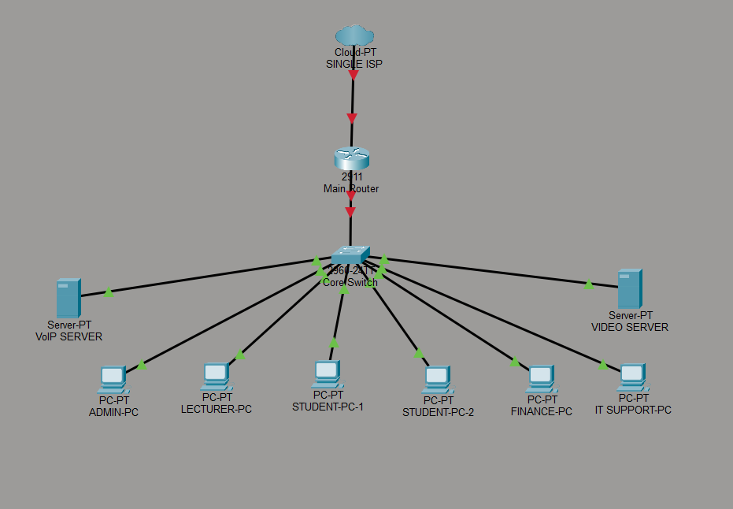
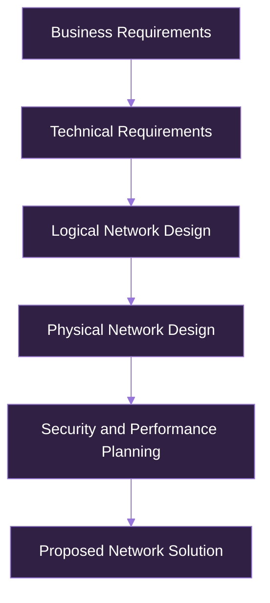
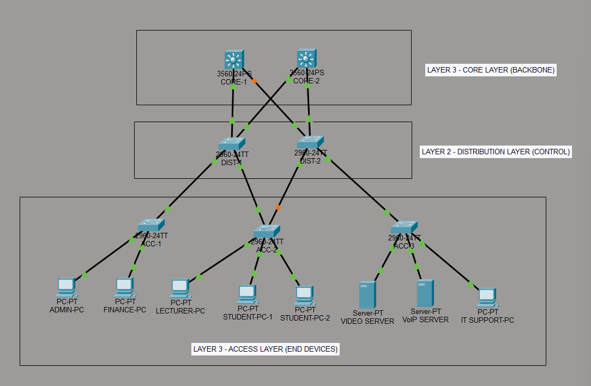
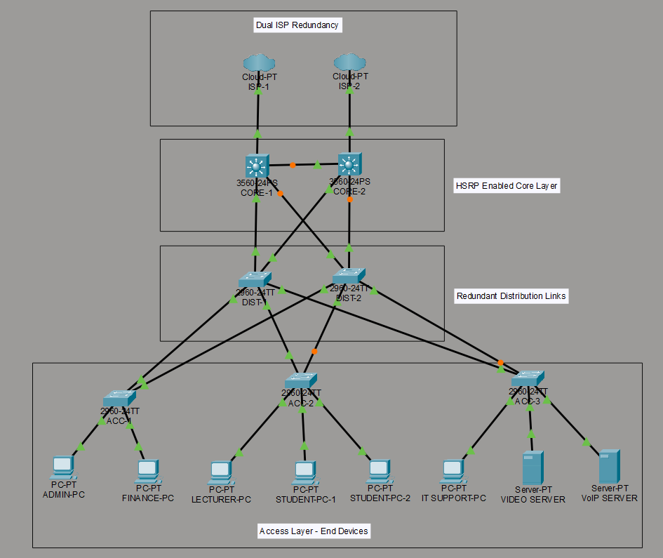

# EduStream Global Network Design

*Scalability. Performance. Reliability.*

---

## 01 / Project Overview

An individual academic network design case study completed for ITT550 Network Design and Management.

The project focused on redesigning EduStream Global's existing network infrastructure to support reliable, scalable and high-performance online learning services.

## 02 / Existing Network Problems

- Flat network topology.
- Excessive broadcast traffic.
- Network congestion.
- High latency and jitter.
- Single point of failure.
- Dependency on a single ISP.
- Unstructured IP addressing.
- Limited network scalability.

### Existing Network Topology

*Figure 1: Existing flat network architecture of EduStream Global.*

## 03 / Network Design Methodology

The Top-Down Network Design approach was selected to ensure that business requirements were considered before selecting technical infrastructure.

## 04 / Hierarchical Network Design

| Layer | Responsibility |
| --- | --- |
| Core | High-speed network backbone |
| Distribution | Inter-VLAN routing, QoS and policy enforcement |
| Access | End-device connectivity and VLAN assignment |

### Proposed Hierarchical Network Topology

*Figure 2: Proposed three-tier hierarchical network architecture.*

The proposed architecture separates network functions into Core, Distribution and Access layers to improve scalability, network performance, manageability and fault isolation.

## 05 / Multi-Site IP Addressing

| VLAN | Department | Medford | Grants Pass | Ashland |
| --- | --- | --- | --- | --- |
| 10 | Management | 10.1.10.0/24 | 10.2.10.0/24 | 10.3.10.0/24 |
| 20 | Administration | 10.1.20.0/24 | 10.2.20.0/24 | 10.3.20.0/24 |
| 30 | Academic Services | 10.1.30.0/24 | 10.2.30.0/24 | 10.3.30.0/24 |
| 40 | VoIP | 10.1.40.0/24 | 10.2.40.0/24 | 10.3.40.0/24 |
| 50 | Video Streaming | 10.1.50.0/24 | 10.2.50.0/24 | 10.3.50.0/24 |
| 60 | Guest Network | 10.1.60.0/24 | 10.2.60.0/24 | 10.3.60.0/24 |
| 70 | Data Centre | 10.1.70.0/24 | 10.2.70.0/24 | 10.3.70.0/24 |

## 06 / Routing and Network Services

The proposed network incorporates:

- OSPF dynamic routing.
- Inter-VLAN routing.
- Structured IPv4 addressing.
- DHCP services.
- DNS services.
- Standardized network naming conventions.

## 07 / Quality of Service

### Traffic Classification

| Traffic | DSCP | Priority |
| --- | --- | --- |
| VoIP | EF (46) | Highest |
| HD Video | AF41 (34) | High |
| LMS Traffic | Policy-based | Medium |
| Best-Effort Traffic | Default (0) | Low |

### Bandwidth Allocation

| Queue | Traffic Class | Allocation |
| --- | --- | --- |
| LLQ | VoIP and Video | 40% |
| CBWFQ 1 | LMS and Signaling | 30% |
| CBWFQ 2 | Management | 10% |
| Default | Best-Effort Traffic | 20% |

### Proposed QoS Techniques

- Priority Queuing (PQ).
- Low Latency Queuing (LLQ).
- Weighted Fair Queuing (WFQ).
- Traffic shaping.
- Traffic policing.
- End-to-end traffic prioritization.

## 08 / Redundancy and High Availability

| Technology | Purpose |
| --- | --- |
| Dual ISP | Internet connection redundancy |
| Redundant Core Switches | Reduce single points of failure |
| EtherChannel | Link aggregation and redundancy |
| HSRP / VRRP | Default gateway redundancy |
| OSPF | Dynamic route recovery |
| RAID | Disk failure protection |
| Load Balancing | Server workload distribution |
| Backup Power | Improve service continuity |

### Proposed High Availability Topology

*Figure 3: Proposed redundant network architecture supporting high availability.*

The proposed architecture aims to reduce single points of failure and improve network resilience through redundant infrastructure and alternative network paths.

## 09 / Performance Requirements

| Metric | Target |
| --- | --- |
| Network Availability | 99.99% |
| VoIP Latency | Below 150 ms |
| VoIP Jitter | Below 30 ms |
| Packet Loss | Below 1% |

These values represent design requirements and performance objectives rather than measured simulation results.

## 10 / Business Considerations

- Cost-efficient infrastructure.
- Scalability for business expansion.
- Long-term network maintainability.
- Business continuity.
- Balance between performance and budget.
- Practical technology selection.

## 11 / Technical Skills Developed

- Top-Down Network Design.
- Enterprise network architecture.
- Multi-site IP addressing.
- VLAN planning.
- Routing and switching concepts.
- Quality of Service.
- Network redundancy.
- Infrastructure planning.
- Technical documentation.

## 12 / Project Status

- [x] Network requirement analysis.
- [x] Hierarchical network design.
- [x] VLAN and IP addressing plan.
- [x] QoS strategy.
- [x] Redundancy planning.
- [x] Academic design documentation.
- [ ] Practical network implementation.
- [ ] Performance validation.
- [ ] Failover testing.

## 13 / Disclaimer

This project represents an individual academic network design proposal.

The proposed technologies and performance targets have not been verified through a production deployment.

---

[Return to Main Repository](../README.md)
