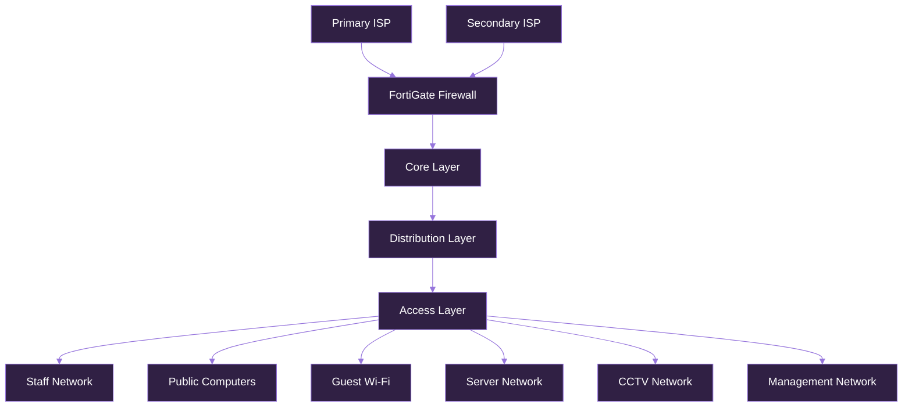
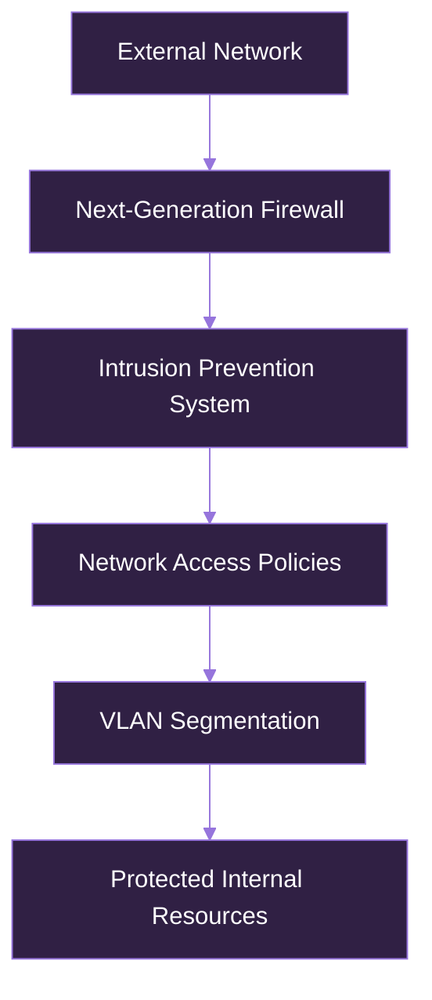
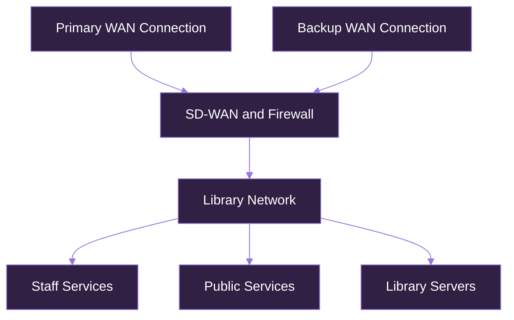

# LIBRIFY Public Library Network Design

*Secure Infrastructure. Reliable Connectivity. Scalable Architecture.*

---

## 01 / Project Overview

LIBRIFY Public Library Network Design is a collaborative academic project focusing on the redesign of an existing public library network infrastructure.

The project proposes a scalable, secure and reliable enterprise network architecture to support library staff, public computer users, wireless visitors and digital library services.

| Item | Description |
| --- | --- |
| Course | ITT550 Network Design and Management |
| Institution | Universiti Teknologi MARA (UiTM) |
| Year | 2026 |
| Project Type | Group Academic Project |
| Team Size | 3 Members |
| Project Status | Network Design Proposal |

## 02 / Existing Network Problems

- Flat network topology.
- Lack of VLAN segmentation.
- Network congestion.
- Insufficient wireless coverage.
- Limited network security.
- Single ISP dependency.
- Lack of network redundancy.
- Manual network troubleshooting.
- Limited infrastructure scalability.
- Lack of secure remote access.

## 03 / Project Objectives

- Improve network performance and reliability.
- Design a scalable hierarchical network.
- Enhance network security and access control.
- Improve wireless network coverage.
- Reduce single points of failure.
- Implement centralized network management in the proposed design.
- Support future infrastructure expansion.

## 04 / Proposed Network Architecture

The proposed network adopts a three-tier hierarchical architecture consisting of Core, Distribution and Access layers.

| Network Layer | Responsibility |
| --- | --- |
| Core | WAN connectivity, firewall and network backbone |
| Distribution | Inter-VLAN routing and policy enforcement |
| Access | End-device connectivity and network segmentation |

## 05 / VLAN Segmentation and IP Addressing

The proposed infrastructure separates network devices and services into six dedicated VLANs.

| VLAN | Network | Subnet |
| --- | --- | --- |
| 10 | Staff | 192.168.10.0/24 |
| 20 | Public | 192.168.20.0/24 |
| 30 | Guest | 192.168.30.0/24 |
| 40 | Servers | 192.168.40.0/24 |
| 50 | CCTV | 192.168.50.0/24 |
| 60 | Management | 192.168.60.0/24 |

### Network Segmentation Benefits

- Reduced broadcast traffic.
- Improved network isolation.
- Restricted unauthorized access.
- Better traffic management.
- Simplified troubleshooting.
- Improved infrastructure scalability.

## 06 / Logical Network Design

The proposed logical network design includes:

- Private IPv4 addressing.
- Dedicated /24 subnets.
- Layer 3 switching.
- Switched Virtual Interfaces (SVIs).
- Inter-VLAN routing.
- Centralized DHCP and DNS services.
- Dedicated server infrastructure.
- VLAN-based traffic restrictions.

## 07 / DHCP and DNS Services

Centralized DHCP and DNS services are located within the server VLAN.

### DHCP Server

Server IP address: `192.168.40.12`

| VLAN | DHCP Range |
| --- | --- |
| Staff | 192.168.10.50 - 192.168.10.150 |
| Public | 192.168.20.10 - 192.168.20.200 |
| Guest | 192.168.30.10 - 192.168.30.250 |

Servers, CCTV devices and network management equipment use static IP addressing.

### DNS Services

- Centralized name resolution.
- Improved internal resource accessibility.
- Simplified network administration.
- Consistent network naming.

## 08 / Physical Network Design

The physical infrastructure proposal includes:

- Ground floor network layout.
- First floor network layout.
- Dedicated server room.
- Network equipment rack.
- Structured cabling plan.
- Wireless access point placement.
- Network switch placement.
- CCTV infrastructure.

### Proposed Infrastructure Technologies

| Technology | Purpose |
| --- | --- |
| Gigabit Ethernet | High-speed wired connectivity |
| 10 Gigabit Fiber | High-speed backbone connectivity |
| Cat6a Cabling | Structured network cabling |
| Enterprise Wi-Fi 6 | Wireless network connectivity |
| Layer 3 Switch | Inter-VLAN routing |
| Layer 2 Switch | End-device connectivity |
| UPS | Backup power supply |
| FortiGate Firewall | Network security and traffic inspection |

## 09 / Network Security Architecture

The proposed security architecture follows a defense-in-depth approach, incorporating multiple layers of protection.

### Proposed Security Controls

| Security Control | Purpose |
| --- | --- |
| NGFW | Advanced network traffic inspection |
| IPS | Intrusion detection and prevention |
| VLAN Segmentation | Logical network isolation |
| 802.1X | Network access authentication |
| Web Filtering | Restrict inappropriate or malicious websites |
| SSL VPN | Secure remote connectivity |
| MFA | Additional authentication protection |
| SNMPv3 | Secure network monitoring |
| Firewall Policies | Restrict unauthorized network traffic |

## 10 / Firewall and Access Control Policies

The proposed network follows the principle of least privilege.

| Source | Destination | Policy |
| --- | --- | --- |
| Staff | Authorized Servers | Permit required services |
| Public | Library Catalogue | Permit HTTP/HTTPS |
| Public | Internet | Permit filtered web traffic |
| Guest | Internet | Permit filtered web traffic |
| Guest | Internal Network | Deny |
| CCTV | NVR Server | Permit required RTSP traffic |
| CCTV | Internet | Deny |
| IT Staff | Management Network | Permit authorized access |
| Unauthorized Traffic | Protected Resources | Deny and Log |

Traffic that is not explicitly permitted is blocked according to the proposed security policy.

## 11 / WAN Connectivity and High Availability

The proposed infrastructure introduces redundant WAN connections and automatic failover.

### Proposed Availability Solutions

- Dual ISP connectivity.
- SD-WAN automatic failover.
- WAN load balancing.
- Application-based routing.
- Redundant network links.
- Rapid Spanning Tree Protocol (RSTP).
- UPS backup power.

## 12 / Network Monitoring and Management

The proposed infrastructure incorporates centralized network monitoring to improve operational visibility and simplify troubleshooting.

### Monitoring Scope

- Network device availability.
- Interface and link status.
- Network performance.
- Bandwidth utilization.
- Security events.
- WAN connection availability.
- Infrastructure health.

SNMPv3 is proposed to provide authenticated and encrypted network monitoring.

## 13 / Existing vs Proposed Infrastructure

| Feature | Existing | Proposed |
| --- | --- | --- |
| Architecture | Flat Network | Three-Tier Hierarchical |
| Segmentation | None | Six VLANs |
| Network Security | Basic Router Firewall | NGFW and IPS |
| Wireless Network | Consumer Access Points | Enterprise Wi-Fi 6 |
| Remote Access | None | SSL VPN with MFA |
| WAN Connectivity | Single ISP | Dual ISP with SD-WAN |
| Monitoring | Manual Troubleshooting | Centralized SNMPv3 |
| Redundancy | Limited | Redundant Links and UPS |

## 14 / Design Performance Targets

| Metric | Target |
| --- | --- |
| Network Availability | 99.9% |
| Network Failover | Less than 2 seconds |
| WAN Failover | Less than 5 seconds |
| Catalogue Search Response | Less than 2 seconds |
| Wireless Coverage | 100% |
| Future Infrastructure Growth | 30% |

These values represent proposed design targets rather than measured implementation results.

## 15 / Technical Skills Developed

- Enterprise network architecture.
- Logical and physical network design.
- IPv4 addressing and subnetting.
- VLAN segmentation.
- Inter-VLAN routing.
- Firewall policy design.
- Network security architecture.
- Secure remote access planning.
- WAN redundancy.
- Network monitoring.
- Infrastructure planning.
- Collaborative technical documentation.

## 16 / Project Status

- [x] Existing network analysis.
- [x] Network requirement analysis.
- [x] Hierarchical network design.
- [x] Logical network design.
- [x] Physical network design.
- [x] VLAN and IP addressing plan.
- [x] Network security planning.
- [x] WAN redundancy planning.
- [x] Academic project documentation.
- [ ] Practical infrastructure deployment.
- [ ] Network performance validation.
- [ ] Security and failover testing.

## 17 / Future Improvements

- Develop a dedicated Cisco Packet Tracer simulation.
- Implement VLAN and inter-VLAN routing configurations.
- Test DHCP and DNS services.
- Validate network access control policies.
- Explore firewall configuration in a virtual lab.
- Perform network redundancy and failover tests.
- Explore SNMPv3 monitoring in a practical environment.
- Develop network automation scripts.

## 18 / Disclaimer

This project represents a collaborative academic network design proposal completed for ITT550 Network Design and Management.

The proposed network technologies, architecture and performance targets have not been verified through a production deployment.

This repository documents the project for educational and professional portfolio purposes.

---

*Design. Protect. Connect.*

[Return to Main Repository](../README.md)

